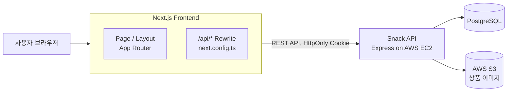
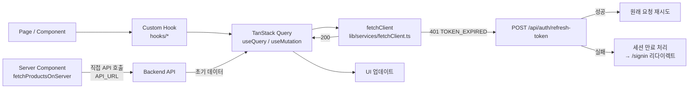
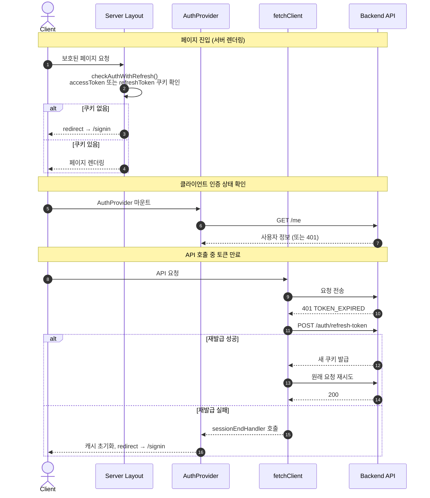
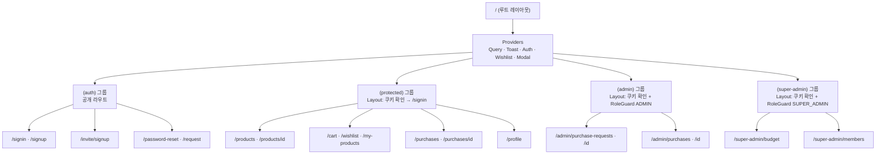

<div align="center">

# SNACK 🍪 Frontend

### 사내 간식 구매부터 관리까지, 한 곳에서.

**원스톱 간식 구매 관리 서비스 SNACK**의 웹 클라이언트  
팀 프로젝트에서 **상품 화면 전체와 찜 기능, 공용 메뉴 컴포넌트**를 맡았습니다.

<br />

[Backend 저장소](https://github.com/seonghwi-ha/13-2-snack-be) · [팀 원본 저장소](https://github.com/myfunnyhome/13-2-snack-fe)

</div>

---

# 📜 목차

1. [프로젝트 소개](#-프로젝트-소개)
2. [내 역할](#-내-역할)
3. [기술 스택](#️-기술-스택)
4. [주요 작업 내역](#-주요-작업-내역)
5. [성능 최적화](#-성능-최적화)
6. [트러블 슈팅](#-트러블-슈팅)
7. [팀 정보](#-팀-정보)
8. [아키텍처](#-architecture) · [인증](#-authentication--authorization) · [페이지](#-page-overview) · [라우팅](#-routing-structure) · [실행 방법](#️-getting-started)

<br/>

# 📝 프로젝트 소개

여러 플랫폼에 흩어진 사내 간식 구매 내역을 한 곳에서 관리하는 서비스입니다.  
직원은 상품을 등록하고 구매를 요청하며, 관리자는 월 예산 안에서 승인·반려합니다.

- 🔐 로그인 / 회원가입 / 초대 회원가입 / 비밀번호 재설정
- 🛒 상품 목록 · 상세 · 장바구니 · 위시리스트
- 📝 구매 요청 및 내역 조회 · 취소
- ✅ 구매 요청 승인 · 반려 (관리자)
- 💰 예산 현황 조회 및 설정 (최고 관리자)
- 👥 회원 초대 및 관리 (최고 관리자)
- 🗂 내가 등록한 상품 관리

| 구분        | 기간              | 내용                                           |
| ----------- | ----------------- | ---------------------------------------------- |
| 팀 프로젝트 | 2026.09 ~ 2026.10 | 프론트엔드 팀원으로 상품 화면 담당 (PR 17건)   |
| 개인 포크   | 2026.10 ~         | 기여 정리, 백엔드 고도화 기능의 화면 연결 예정 |

<br/>

# 🙋 내 역할

| 영역          | 담당 내용                                                                     |
| ------------- | ----------------------------------------------------------------------------- |
| 공용 컴포넌트 | SideMenu, SubCategoryItem, MenuItem, TabMenu, 아이콘                          |
| 상품 화면     | 리스트(무한 스크롤·카테고리·정렬)·상세·등록·수정·삭제와 API 연결              |
| 찜 기능       | 리스트·상세 찜 토글, 찜 개수, 찜 목록 안정화                                  |
| 성능·안정화   | 첫 페이지 서버 조회로 LCP 개선, 이미지 우선 로딩, 에러 경계, 잘못된 주소 처리 |
| 협업          | TypeScript 타입 선언 컨벤션 문서화, 머지로 깨진 주문·장바구니 서비스 복구     |

백엔드에서도 같은 상품 도메인을 맡아, 화면에 필요한 값(`isMine`, `wishlistCount`, `hasNext`)과 고정 카테고리 id를 API·시드에 직접 반영했습니다.

<br/>

# ⚙️ 기술 스택

### ✅ Language


### ✅ Framework & Libraries


### ✅ Styling


### ✅ Test & Tooling


기타: clsx, tailwind-merge, nanoid, React Compiler

<br/>

# 📋 주요 작업 내역

<details>
<summary>🍪 팀 프로젝트 (2026.09 ~ 2026.10)</summary>

- **공용 메뉴 컴포넌트** (#35, #47, #53, #71)
  - 카테고리 사이드 메뉴·소분류 항목·탭·메뉴 항목을 `src/components/ui`에 공용으로 제작
  - 리뷰 반영: 메뉴 데이터 상수 분리, 아이콘 컴포넌트 추출

- **상품 리스트·상세** (#77, #81, #97)
  - `useInfiniteQuery` + `IntersectionObserver` 무한 스크롤, 백엔드 `hasNext`로 다음 페이지 판단
  - 대분류는 `parentCategoryId`(하위 전체), 소분류는 `categoryId`로 나눠 조회
  - 등록·수정 공용 모달, 등록자 본인(`isMine`)·관리자에게만 수정·삭제 노출, 장바구니 담기

- **찜 기능** (#121, #152)
  - 리스트·상세 찜 토글과 찜 개수, 찜 상태를 컴포넌트 state에서 props로 전환(서버가 원본)
  - 찜 수 변경 시 목록 재조회 대신 캐시 숫자만 갱신해 스크롤 유지

- **성능·안정화** (#141, #158)
  - 첫 페이지 서버 조회 + `HydrationBoundary`, 상단 이미지 `priority`
  - 4xx·5xx 구분 재시도와 안내 문구, 상품 화면 에러 경계(`error.tsx`)

- **화면 디테일** (#100, #106, #109, #126)
  - 카테고리 상수를 백엔드 시드 id에 맞춤, 장바구니 담기 후 GNB 개수 갱신
  - 이미지 없는 상품 표시, 제품 링크 입력 안내, 등록 내역에서 상세로 이동

</details>

<details>
<summary>🚀 개인 포크 (2026.10 ~)</summary>

- 팀 프로젝트 기여 정리 ([기여 정리 문서](docs/resume/contributions.md))
- 예정: 백엔드 포크의 커서 페이지네이션(`nextCursor`)과 오타 검색 추천(`suggestions`)을 상품 화면에 연결

</details>

<br/>

# 🚀 성능 최적화

<details>
<summary>1. 상품 목록 첫 페이지 서버 조회 (LCP)</summary>

- **문제**: 목록을 브라우저에서만 받으면 JS 다운로드 → 실행 → API 호출이 끝나야 ``가 생겨, 느린 회선에서 LCP가 5초 넘게 밀림
- **해결**: 서버 컴포넌트에서 첫 페이지를 받아 TanStack Query 캐시에 주입 → HTML이 도착하자마자 이미지 요청 시작
  - 요청 쿠키를 그대로 실어 API 서버를 직접 호출, 3초 타임아웃
  - 실패하면 `null`을 돌려 기존처럼 브라우저에서 조회 (토큰 만료 재발급은 브라우저가 담당)
  - 서버와 화면의 쿼리 키가 어긋나지 않도록 URL → 조회 조건 변환을 한 파일에 모음

</details>

<details>
<summary>2. 이미지 우선 로딩</summary>

- `next/image`는 기본이 lazy라 첫 화면에 이미 보이는 이미지도 늦게 받음
- 첫 화면 상단 이미지에만 `priority`를 주고, 화면 밖 이미지는 대역폭을 뺏지 않게 그대로 둠

</details>

<details>
<summary>3. 확정된 오류는 재시도하지 않기</summary>

- 404·403 같은 4xx는 다시 요청해도 결과가 같은데, 기본 3회 재시도로 오류 표시까지 7초가량 스켈레톤이 남음
- 4xx는 바로 서버 문구를 보여주고, 5xx·네트워크 오류만 재시도와 "다시 시도" 버튼 제공

</details>

<br/>

# 💣 트러블 슈팅

<details>
<summary>1. [성능] 배포 환경에서 첫 페이지 서버 조회가 조용히 꺼져 있던 문제</summary>

- **문제**: 배포 환경에서는 첫 페이지 서버 조회가 동작하지 않아 LCP 개선이 적용되지 않음
- **원인**: 서버 조회가 `NEXT_PUBLIC_API_URL`을 읽었는데 배포에는 서버용 `API_URL`만 있었음. 값이 없으면 에러 없이 브라우저 조회로 넘어가게 만든 탓에 증상이 드러나지 않음
- **해결**: `/api` 프록시와 같은 `API_URL`을 읽도록 수정, "값이 없으면 개선이 꺼진다"는 점을 주석으로 남김 (#158)
- **배운 점**: 실패해도 동작하는 설계는 실패를 숨길 수 있다. 꺼졌을 때 알 수 있는 장치가 필요하다

</details>

<details>
<summary>2. [UI] 찜 하트가 이미지 아래로 밀려나던 문제</summary>

- **원인**: 카드 덮개 링크(z-10) 위로 올리려고 `relative z-20`을 줬더니 `tailwind-merge`가 같은 position 그룹인 카드의 `absolute`를 지움
- **해결**: position은 건드리지 않고 `z-20`만 전달 (#121)

</details>

<details>
<summary>3. [UI] 정렬 목록을 눌러도 뒤의 상품 카드가 눌리던 문제</summary>

- **원인**: 펼친 정렬 목록과 카드 덮개 링크가 같은 `z-10`이라 나중에 그려진 카드 링크가 클릭을 가져감
- **해결**: 정렬 목록을 `z-30`으로 올림 (#121)

</details>

<details>
<summary>4. [찜] 찜하고 바로 찜 목록에 가면 방금 찜한 상품이 빠지던 문제</summary>

- **원인**: 하트를 누른 직후 이동하면 찜 요청이 아직 서버에 가는 중인데 찜 목록을 먼저 조회
- **해결**: 찜 목록을 받기 전에 진행 중인 찜 요청이 끝나기를 기다림. 서버·네트워크 오류는 개발용 문구 대신 안내 문구로 바꾸고 재시도 추가 (#152)

</details>

<details>
<summary>5. [상품 상세] 잘못된 주소에서 로딩 화면이 끝나지 않던 문제</summary>

- **원인**: `/products/abc`처럼 숫자가 아닌 id는 요청을 막았는데, 요청을 안 하면 `isPending`이 계속 true라 스켈레톤이 영원히 남음
- **해결**: 잘못된 주소는 따로 "잘못된 상품 주소입니다."를 보여주고, 오류 화면에는 항상 "상품 목록으로" 길을 둠 (#141)

</details>

<details>
<summary>6. [이미지] 우리 이미지 API 주소가 next/image에서 깨지던 문제</summary>

- **원인**: `next/image` 최적화는 Next 서버가 이미지를 대신 요청해서 브라우저 쿠키가 실리지 않음
- **해결**: 우리 이미지 API(`/api/...`) 주소만 최적화를 끄고 브라우저가 직접 받게 함. 프로젝트 정적 이미지는 그대로 최적화 (#77)

</details>

<details>
<summary>7. [UI] 이미지 없는 상품 카드의 배경까지 흐려지던 문제</summary>

- **원인**: 자리 표시 아이콘을 흐리게 하려고 `opacity`를 카드 바깥에 걸어 배경과 그림자까지 사라짐
- **해결**: `[&_img]:opacity-15`로 안쪽 아이콘에만 적용 (#126)

</details>

<br/>

# 👥 팀 정보

코드잇 풀스택 13기 2팀의 팀 프로젝트입니다. 팀 구성과 전체 작업 이력은 [팀 원본 저장소](https://github.com/myfunnyhome/13-2-snack-fe)에서 볼 수 있습니다.  
이 저장소는 팀 프로젝트를 포크해 개인적으로 이어서 개발하는 저장소입니다.

<br/>

---

## 🏗 Architecture

### System Overview



Next.js의 `rewrites`를 이용해 `/api/*` 경로를 백엔드 서버로 프록시합니다.  
브라우저는 동일 출처(same-origin)로 요청하며, 쿠키는 `credentials: 'same-origin'`으로 자동 전달됩니다.

### Frontend Request / Rendering Flow



상품 목록 첫 페이지는 서버 컴포넌트에서 미리 패치해 TanStack Query 캐시에 주입합니다.  
이후 페이지네이션과 필터는 클라이언트에서 TanStack Query로 처리합니다.

### Project Structure

```text
src
├── app/                   # App Router — 라우트, 레이아웃, 페이지
│   ├── (auth)/            # 비로그인 공개 페이지 (signin, signup, password-reset, invite)
│   ├── (protected)/       # 로그인 필요 페이지 (products, cart, wishlist, purchases, profile)
│   ├── (admin)/           # ADMIN 이상 전용 (purchase-requests 승인·반려, purchases 조회)
│   ├── (super-admin)/     # SUPER_ADMIN 전용 (budget 설정, members 관리)
│   ├── providers.tsx      # 전역 Provider 트리 구성
│   └── layout.tsx         # 루트 레이아웃 (폰트, 전역 CSS)
├── components/
│   ├── auth/              # RoleGuard — 클라이언트 역할 보호 컴포넌트
│   ├── icons/             # SVG 아이콘 컴포넌트
│   └── ui/                # 재사용 공용 UI 컴포넌트 (Button, Modal, Toast, …)
├── hooks/                 # 도메인별 Custom Hook
│   ├── auth/              # 인증 훅
│   ├── cart/              # 장바구니 훅
│   ├── members/           # 회원 관리 훅
│   ├── products/          # 상품 훅
│   ├── purchase-requests/ # 구매 요청 훅
│   ├── purchases/         # 구매 내역 훅
│   ├── common/            # 공통 훅
│   └── wishlist/          # 위시리스트 훅
├── lib/
│   ├── auth/              # 서버 세션 확인 (session.ts), 비밀번호·Zod 스키마
│   └── services/          # API 서비스 레이어 (fetchClient, authService, productService, …)
├── providers/             # Context Provider (Auth, Query, Toast, Modal, Wishlist)
├── constants/             # UI 상수 (메뉴, 뱃지 등)
├── utils/                 # cn(), date, toKoreanWon, getErrorMessage 등
└── assets/                # 폰트, 아이콘, 이미지
```

팀 코딩 컨벤션은 [FE_CONVENTION.md](FE_CONVENTION.md)에 정리되어 있습니다.

## 🔐 Authentication & Authorization

서버가 발급한 **HttpOnly 쿠키**(accessToken · refreshToken)를 기반으로 인증합니다.



**서버 레이아웃 보호** — `(protected)`, `(admin)`, `(super-admin)` 그룹의 `layout.tsx`가 서버에서 쿠키를 확인하고 비인증 접근을 `/signin`으로 리다이렉트합니다.

**역할 보호 (클라이언트)** — `RoleGuard` 컴포넌트가 `AuthProvider`의 사용자 정보를 읽어 접근 권한을 검사합니다. 권한이 없으면 `/products` 또는 `/signin`으로 리다이렉트합니다.

**토큰 자동 재발급** — `fetchClient`는 `TOKEN_EXPIRED` 에러를 받으면 Refresh Token으로 재발급을 시도하고, 성공하면 원래 요청을 재시도합니다. 동시 요청이 있을 경우 재발급 요청은 하나만 실행됩니다(`refreshPromise` 공유).

| 역할          | 접근 가능 페이지                                                      |
| ------------- | --------------------------------------------------------------------- |
| `GENERAL`     | 상품 목록·상세, 장바구니, 위시리스트, 구매 요청·내역, 내 상품, 프로필 |
| `ADMIN`       | GENERAL 페이지 + 구매 요청 승인·반려, 구매 내역 조회                  |
| `SUPER_ADMIN` | ADMIN 페이지 + 예산 설정, 회원 초대·관리                              |

## 📄 Page Overview

| Route                           | 대상         | 주요 기능                                     |
| ------------------------------- | ------------ | --------------------------------------------- |
| `/`                             | 전체         | 랜딩 페이지                                   |
| `/signin`                       | 비로그인     | 이메일 · 비밀번호 로그인                      |
| `/signup`                       | 비로그인     | 기업 담당자(SUPER_ADMIN) 회원가입             |
| `/invite/signup`                | 비로그인     | 초대 링크 기반 회원가입                       |
| `/password-reset/request`       | 비로그인     | 비밀번호 재설정 메일 요청                     |
| `/password-reset`               | 비로그인     | 새 비밀번호 설정                              |
| `/products`                     | GENERAL 이상 | 상품 목록 (검색 · 카테고리 필터 · 정렬)       |
| `/products/[id]`                | GENERAL 이상 | 상품 상세 · 장바구니 담기 · 위시리스트 추가   |
| `/cart`                         | GENERAL 이상 | 장바구니 목록 · 수량 변경 · 구매 요청 생성    |
| `/wishlist`                     | GENERAL 이상 | 위시리스트 목록                               |
| `/my-products`                  | GENERAL 이상 | 내가 등록한 상품 목록                         |
| `/purchases`                    | GENERAL 이상 | 내 구매 요청 내역 · 상태 확인 · 취소          |
| `/purchases/[id]`               | GENERAL 이상 | 구매 요청 상세                                |
| `/profile`                      | GENERAL 이상 | 프로필 조회 · 비밀번호 · 회사명 변경          |
| `/admin/purchase-requests`      | ADMIN 이상   | 조직 구매 요청 목록                           |
| `/admin/purchase-requests/[id]` | ADMIN 이상   | 구매 요청 상세 · 승인 · 반려 (예산 확인 포함) |
| `/admin/purchases`              | ADMIN 이상   | 처리된 구매 내역 조회                         |
| `/admin/purchases/[id]`         | ADMIN 이상   | 처리된 구매 상세                              |
| `/super-admin/budget`           | SUPER_ADMIN  | 이번 달 · 기본 예산 설정                      |
| `/super-admin/members`          | SUPER_ADMIN  | 회원 초대 · 검색 · 권한 변경 · 탈퇴 처리      |

## 🗺 Routing Structure



각 Route Group의 `layout.tsx`가 서버에서 쿠키를 검사해 비인증 요청을 차단합니다.  
역할 검사는 `RoleGuard` 클라이언트 컴포넌트가 추가로 담당합니다.

## 🚀 CI/CD & Deployment

현재 자동 배포 파이프라인은 구성되어 있지 않습니다.

| 단계             | 현재 상태     |
| ---------------- | ------------- |
| 자동 빌드 · 배포 | 미구성        |
| 로컬 개발 서버   | `npm run dev` |

## ⚙️ Getting Started

```bash
cp .env.example .env   # 값 입력 후 진행
npm install
npm run dev            # 개발 서버, http://localhost:3000
```

| 명령                 | 설명                 |
| -------------------- | -------------------- |
| `npm run dev`        | 개발 서버 실행       |
| `npm run build`      | 프로덕션 빌드        |
| `npm start`          | 프로덕션 서버 실행   |
| `npm run lint`       | ESLint 검사          |
| `npm run type-check` | TypeScript 타입 검사 |
| `npm test`           | Jest 테스트 실행     |
| `npm run test:watch` | Jest Watch 모드      |

## 🔑 Environment Variables

실제 값은 저장소에 포함하지 않습니다. 형식은 [`.env.example`](.env.example)을 참고하세요.

| 변수      | 용도                                                             |
| --------- | ---------------------------------------------------------------- |
| `API_URL` | 백엔드 API 서버 주소 — `next.config.ts`의 `/api/*` 리라이트 대상 |
